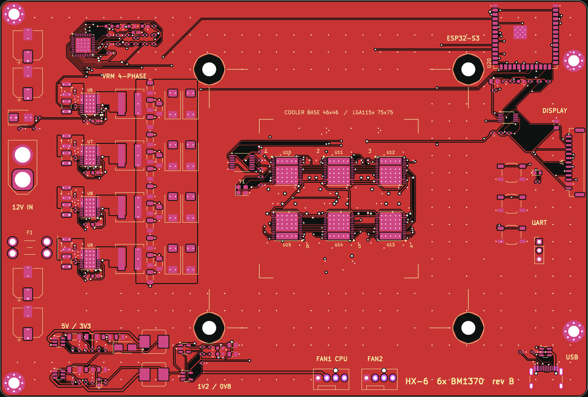
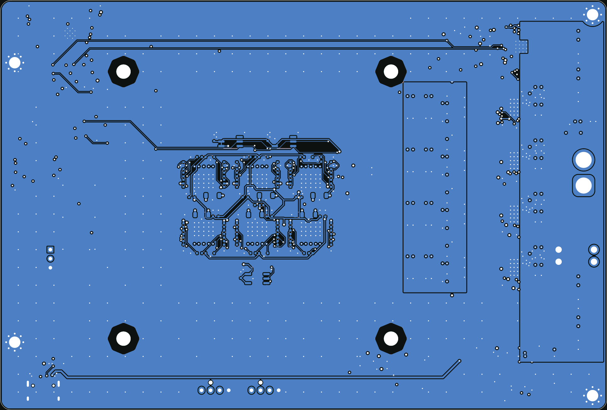
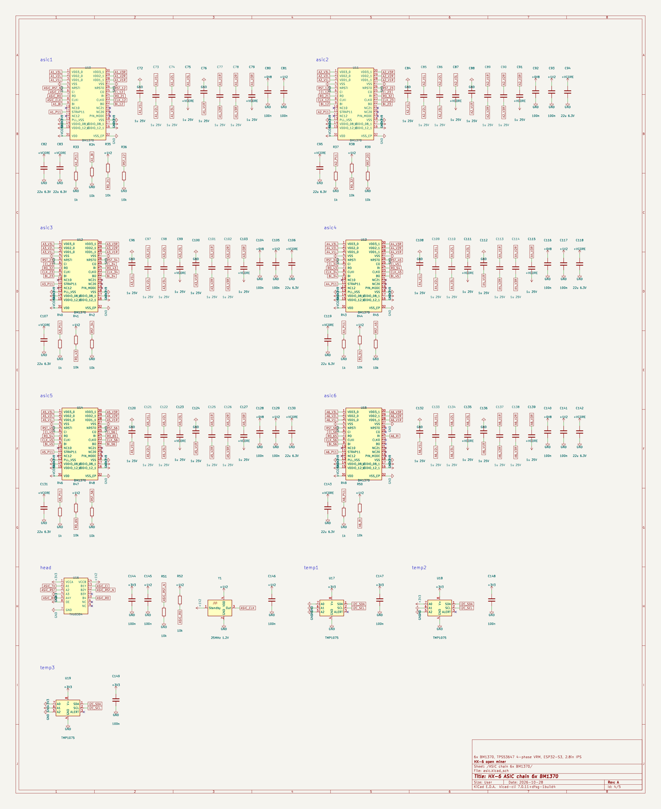
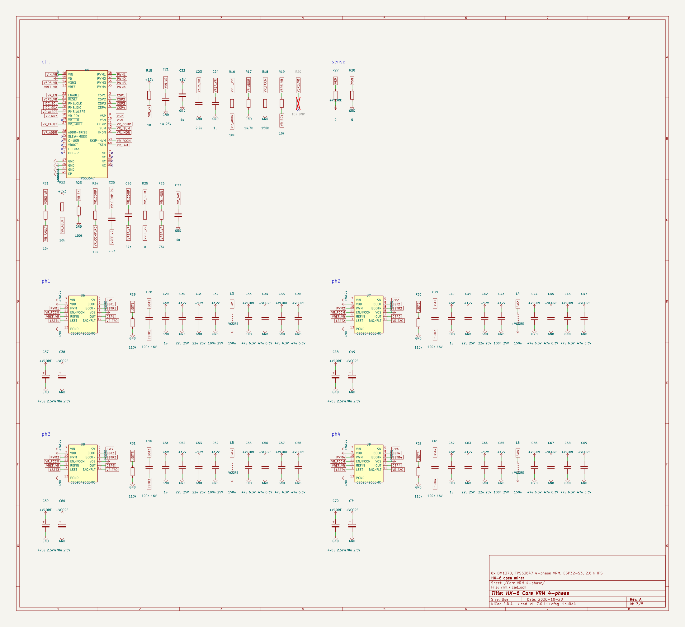

# HX-6

A 6 chip BM1370 Bitcoin miner board with a touchscreen, made in KiCad.

Six BM1370s (the chip from the Antminer S21 Pro) sit under one normal desktop CPU cooler, powered by a 4 phase VRM off 12 V. An ESP32-S3 runs it over WiFi and drives a 2.8" touch display.



## Specs

| | |
|---|---|
| ASICs | 6x BM1370 on one core rail |
| Expected hashrate | about 6 to 7 TH/s at stock settings |
| Power | 12 V in through XT60, around 100 to 110 W |
| Core VRM | TI TPS53647, 4 phases with CSD95490Q5MC power stages |
| Controller | ESP32-S3-WROOM-1 (N16R8), USB-C for flashing |
| Screen | Waveshare 2.8" capacitive touch LCD (ST7789 + CST328), plugs into the 13 pin GH1.25 socket |
| Cooling | any Intel LGA115x / 1200 CPU cooler, 2 PWM fan headers |
| Board | 6 layers, 170 x 115 mm |

## Status

Rev B. Fully routed, DRC clean in KiCad 7, Gerbers ready for JLCPCB.

**Not built or tested yet.** Treat it as a first prototype. If you build one, open an issue and tell me how it went.

## Layout

The board reads left to right: 12 V input, the four VRM phases, the ASIC block, then the ESP32, buttons, display socket and USB. The small 5 V, 3.3 V, 1.2 V and 0.8 V rails run along the bottom edge.

The six chips are in a 3 x 2 grid that fits inside a 46 x 46 mm square, so one cooler base covers all of them. The data chain goes 1 → 2 → 3 along the top row and comes back 4 → 5 → 6 along the bottom. Only the chips are on the top side under the cooler. All their capacitors are on the back, right under each chip.



## Schematic

Four sheets: power input and rails, core VRM, ASIC chain, and controller / display / fans.





## Files

```
hx6.kicad_pro          KiCad project (open this)
hx6.kicad_pcb          the board
*.kicad_sch            schematic sheets
hx6.kicad_sym          custom symbols
hx6.pretty/            custom footprints (BM1370, power stage, cooler hole)
fab/                   Gerber zip, BOM and CPL for JLCPCB
docs/                  images and design notes
```

It was made in KiCad 7 and opens fine in KiCad 8, 9 and 10.

## Ordering

Upload `fab/HX6_revB_gerbers_JLCPCB.zip` to JLCPCB and pick:

- 6 layers, 1.6 mm, ENIG
- 2 oz inner copper (the core rail pulls about 100 A)
- epoxy filled and capped vias. There are vias inside the chip pads and they need this.

For assembly, add `fab/HX6_revB_BOM_JLCPCB.csv` and `fab/HX6_revB_CPL_JLCPCB.csv` and match the LCSC parts in their tool. JLCPCB doesn't stock the BM1370, so you'll have to supply those or solder them yourself. Check the part rotations in their preview, especially on the bottom side.

## Before you order

- Run DRC once more in your KiCad version.
- The VRM compensation values are a starting point. Check the core rail at low load before you put real load on it.
- The 25 MHz oscillator has to be a 1.2 V part (Taitien OXLTDLJANF-25.000000 or similar).
- R20 is not fitted on purpose. VR_HOT on the VRM controller isn't used.

## Firmware

There's no HX-6 firmware yet. [ESP-Miner-NerdQAxePlus](https://github.com/shufps/ESP-Miner-NerdQAxePlus) already supports 6x BM1370 with the same TPS53647 VRM, so a port mostly needs this board's pin map (in [docs/design-notes.md](docs/design-notes.md)) and drivers for the 2.8" screen and the CST328 touch chip.

## Credits

Bitmain doesn't publish a BM1370 datasheet. The pin map and footprint come from the open hardware work in [shufps/qaxe](https://github.com/shufps/qaxe) (NerdQAxe++). Check their license if you reuse those parts. The rest of the board was designed for this project.

Full technical notes (pin map, I2C addresses, layer stack, part choices) are in [docs/design-notes.md](docs/design-notes.md).
